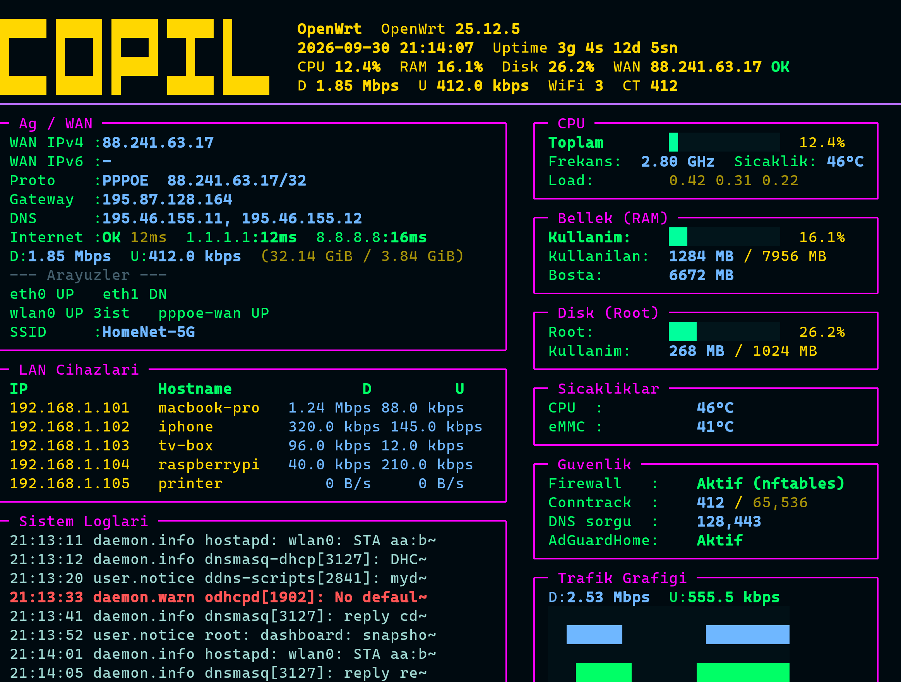
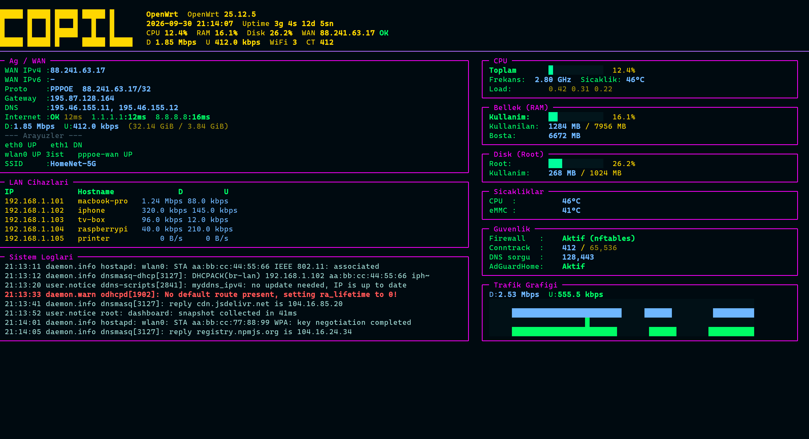

<div align="center">

# OpenWrt Live Dashboard

**A full-screen, neon-styled live status board for OpenWrt routers.**

Turn a small x86 box with an HDMI panel into a professional-looking network
appliance display — CPU, memory, disk, WAN, live traffic graphs, LAN clients,
firewall state and system logs, refreshed once per second.

[](https://www.python.org/)
[](https://textual.textualize.io/)
[](https://openwrt.org/)
[](#requirements)
[](LICENSE)



<sub>The real thing on a 7" 800×600 HDMI panel (100×37 character cells). Panel labels are Turkish — see the [label glossary](#-ui-label-glossary).</sub>

</div>

---

## Table of contents

- [Why](#-why)
- [Features](#-features)
- [Screenshots](#-screenshots)
- [Requirements](#-requirements)
- [Installation](#-installation)
  - [Quick start](#quick-start-on-the-router)
  - [Step-by-step, with every gotcha](#step-by-step-installation)
  - [Kiosk mode vs. procd service](#kiosk-mode-inittab-vs-procd-service)
  - [No package manager at all](#fallback-no-package-manager-at-all)
  - [Uninstall](#uninstall)
- [Deploying from Windows](#-deploying-from-windows-the-authors-workflow)
- [Configuration](#-configuration)
- [Keyboard shortcuts](#-keyboard-shortcuts)
- [Project structure](#-project-structure)
- [Data sources](#-data-sources)
- [Design notes](#-design-notes)
- [UI label glossary](#-ui-label-glossary)
- [Troubleshooting](#-troubleshooting)
- [Development](#-development)
- [FAQ](#-faq)
- [License](#-license)

---

## 🎯 Why

A router with a screen usually boots into a black text console that prints boot
messages and then sits there doing nothing useful. This project replaces that
console with an always-on dashboard that starts automatically on `tty1` the
moment the machine powers up — no desktop environment, no browser, no X11,
just Python and the Linux framebuffer console.

It was built for a **LattePanda 3 Delta** (x86/64) running **OpenWrt 25.12.5**
with a **7-inch 800×600 HDMI panel**, and every layout decision was verified on
that exact display.

---

## ✨ Features

| Panel | What it shows |
|---|---|
| **Header** | Block-letter logo, hostname, OpenWrt version, date/time, uptime, CPU/RAM/Disk %, WAN address, download/upload rates, Wi-Fi client count, conntrack |
| **Network / WAN** | WAN IPv4 + IPv6, PPPoE protocol & address, gateway, DNS servers, internet reachability with latency, per-host ping (loss %), live download/upload rate, cumulative traffic, interface states, SSID |
| **LAN Clients** | Connected devices: IP, hostname, current download and upload rate per device |
| **System Logs** | Last log lines with compressed timestamps; warnings and errors highlighted in bold red |
| **CPU** | Total utilisation bar, current clock frequency, package temperature, load average (1/5/15 min) |
| **Memory** | Usage bar, used / total MB, available MB |
| **Disk** | Root filesystem usage bar and used / total MB |
| **Temperatures** | CPU and eMMC / NVMe sensor readings |
| **Security** | Firewall backend and state, conntrack entries used / max, DNS query count, AdGuard Home status |
| **Traffic Graph** | Two-band live sparkline history (download in blue, upload in green) |

Planned/unmounted widgets live in the repo and can be enabled by adding one line
to `compose()` — see `widgets/vpn.py` (WireGuard / OpenVPN) and
`widgets/docker.py` (container list with CPU/RAM).

**Nice touches**

- **Never crashes on odd output.** Every collector call is wrapped; a missing
  `ubus` reply, an absent `iwinfo` or a dead sensor degrades to `—` instead of
  raising.
- **Cached expensive probes.** Ping, Wi-Fi scanning, ARP/conntrack parsing and
  Docker stats are memoised with a TTL so the UI stays smooth at 1 Hz.
- **Delta-based rates.** Speeds are computed from byte counters between ticks,
  so you get real throughput rather than averages.
- **Boot-message cleanup.** Kernel messages printed during boot are wiped by a
  short full-screen repaint loop so they never stay on top of the dashboard.

---

## 📸 Screenshots

| 7" 800×600 (100×37) — the target device | Wide terminal (180×48) |
|---|---|
|  |  |

Both images are generated from a **fictional sample dataset** (fake IPs,
hostnames and MACs) so no real network details leak into the repository. You can
regenerate them yourself on any OS:

```bash
python tools/make_screenshots.py
```

That writes `docs/screenshot-7in.{svg,png}` and `docs/screenshot-wide.{svg,png}`.
See [Development](#-development) for why the PNGs exist and how the conversion
works.

---

## 📋 Requirements

**On the router**

| Item | Notes |
|---|---|
| OpenWrt | 21.02 or newer. Tested on **25.12.5** (x86/64). Works on any target with `/proc` and `/sys`. |
| Python | **3.11+** (3.13.9 on the reference device). |
| Python packages | `textual >= 0.60`, `rich >= 13.0` (installed by `install.sh`). |
| Shell tools | Whatever the image already has: `ubus`, `iwinfo`, `ip`, `logread`, `wg`. Missing tools are tolerated. |
| Display | Any framebuffer console (`/dev/fb0` + `tty1`). Verified at 800×600 with an 8×16 console font. |

**On your build machine**

| Item | Notes |
|---|---|
| Python | 3.11+ if you want to run the tests or regenerate screenshots. |
| `tar` / `scp` / `ssh` | For the deploy workflow shown below. |

---

## 🚀 Installation

### Quick start (on the router)

```sh
# copy the project archive to the router first, then:
cd /tmp/owd
sh install.sh          # dependencies + files + kiosk autostart
reboot                 # dashboard appears on HDMI
```

That is the whole thing. The rest of this section explains what happens, how to
verify it and how to recover if something goes wrong.

---

### Step-by-step installation

#### 0. Scope out the device first

```sh
cat /etc/openwrt_release            # which OpenWrt release?
command -v apk opkg python3 pip3    # what is already installed?
```

Two things surprise people:

- **OpenWrt 25.x uses `apk`, not `opkg`.** If `opkg` is missing, that is
  expected; `install.sh` detects and uses whichever exists.
- **Minimal images ship without Python at all.** `install.sh` installs it, and
  if the image has neither `apk` nor `opkg` there is a
  [standalone fallback](#fallback-no-package-manager-at-all).

#### 1. Build and transfer the archive

From your workstation, in the project directory:

```sh
tar -czf openwrt-dashboard.tar.gz \
    --exclude=".venv" --exclude="__pycache__" --exclude="*.pyc" \
    -C . .

scp -O openwrt-dashboard.tar.gz root@192.168.1.1:/tmp/
```

> **`-O` is mandatory.** Dropbear on OpenWrt usually has no `sftp-server`, and
> modern OpenSSH `scp` defaults to SFTP. Without `-O` you get
> `sftp-server: not found`. `-O` forces the legacy SCP protocol, which works.

> **Line endings.** If you created the files on Windows, they are CRLF. That
> breaks the `#!/bin/sh /etc/rc.common` shebang of the init script (BusyBox
> tries to execute `rc.common` and fails with a `.common` error). Convert to LF
> before archiving:
>
> ```powershell
> python -c "import pathlib; p=pathlib.Path(r'.'); [f.write_bytes(f.read_bytes().replace(b'\r\n', b'\n')) for f in p.rglob('*') if f.is_file() and f.suffix in {'.py','.sh','.init','.tcss','.md','.json'} and '.venv' not in str(f) and '__pycache__' not in str(f)]"
> ```

#### 2. Unpack and install

```sh
ssh root@192.168.1.1
cd /tmp && rm -rf owd && mkdir owd && tar xzf openwrt-dashboard.tar.gz -C owd
cd owd && sh install.sh
```

If SSH refuses to connect after a reflash, clear the stale host key on your
workstation:

```sh
ssh-keygen -R 192.168.1.1
```

#### 3. What `install.sh` does

1. **Installs Python.** `apk add python3` (or `opkg install python3`), then a
   pip provider. Note the package name is **`python3-pip`**, *not* `py3-pip`.
2. **Installs the TUI libraries** with `pip3 install --upgrade textual rich`.
   On slower devices this takes a minute or two.
3. **Copies the project** to `/root/openwrt-dashboard`.
4. **Installs a procd service** at `/etc/init.d/openwrt-dashboard`.
5. **Enables kiosk mode** (default): backs up `/etc/inittab`, removes the
   console login line, and adds a `respawn` line so the dashboard owns `tty1`
   (the HDMI output). The procd service is disabled in this mode so the
   dashboard does not run twice.

#### 4. Verify

```sh
cd /root/openwrt-dashboard
python3 -m py_compile dashboard.py core/*.py widgets/*.py && echo "COMPILE OK"
python3 tests/smoke_test.py                 # prints SMOKE TEST OK
ps w | grep dashboard                       # the process should be listed
grep -n tty1 /etc/inittab                   # the respawn line should be there
```

Expected inittab line:

```text
tty1::respawn:/bin/sh /root/openwrt-dashboard/run-dashboard.sh
```

> **Why a wrapper script and not `/bin/sh -c '...'`?** BusyBox `init` does not
> interpret shell syntax in `/etc/inittab` — redirects and quoted `sh -c`
> commands are silently ignored. Giving the line the id `tty1` makes BusyBox
> attach stdio to that terminal; everything else (environment, boot-message
> cleanup) is done inside `run-dashboard.sh`.

#### 5. Reboot

```sh
reboot
```

The dashboard now starts automatically on every boot.

**Reloading without a reboot**

```sh
init q            # re-read /etc/inittab
killall python3   # kill the dashboard; respawn restarts it
```

> BusyBox `pkill -f` is unreliable here — use `killall python3`.

---

### Kiosk mode (inittab) vs. procd service

| | Kiosk mode (default) | procd service |
|---|---|---|
| Started by | BusyBox `init` on `tty1` | procd |
| Output | HDMI console — what you want | `/dev/console` |
| Auto-restart | `respawn` | `procd_set_param respawn` |
| Typical use | A dedicated appliance display | Headless boxes, debugging |

Install as a plain service instead:

```sh
KIOSK=0 sh install.sh
/etc/init.d/openwrt-dashboard enable
/etc/init.d/openwrt-dashboard start
```

Do **not** enable both — you would end up with two dashboards fighting over the
console.

---

### Fallback: no package manager at all

If the image has neither `apk` nor `opkg` (custom or heavily stripped builds),
`service/bootstrap_python.sh` downloads a self-contained
[python-build-standalone](https://github.com/astral-sh/python-build-standalone)
musl build into `/opt/python`, exposes it as `/usr/bin/python3`, and installs
`pip`:

```sh
sh service/bootstrap_python.sh
sh install.sh
```

---

### Uninstall

```sh
sh install.sh --uninstall
```

Stops and removes the service, restores `/etc/inittab` from the backup and
deletes `/root/openwrt-dashboard`.

---

## 🪟 Deploying from Windows (the author's workflow)

The reference device is a LattePanda next to a Windows workstation, so this is
the exact loop used while developing. It is the same as
[step 1–2](#1-build-and-transfer-the-archive) above, only spelled out for
PowerShell:

```powershell
$py = 'C:/Users/Copil/AppData/Local/Python/pythoncore-3.14-64/python.exe'

# 1. normalise line endings (create_file writes CRLF on Windows)
& $py -c "import pathlib; p=pathlib.Path(r'f:/OenWRTUI'); [f.write_bytes(f.read_bytes().replace(b'\r\n', b'\n')) for f in p.rglob('*') if f.is_file() and f.suffix in {'.py','.sh','.init','.tcss','.md','.json'} and '.venv' not in str(f) and '__pycache__' not in str(f)]; print('LF OK')"

# 2. archive and transfer
tar -czf f:\openwrt-dashboard.tar.gz --exclude=".venv" --exclude="__pycache__" --exclude="*.pyc" -C f:\OenWRTUI .
scp -O -o StrictHostKeyChecking=accept-new f:\openwrt-dashboard.tar.gz root@192.168.1.1:/tmp/

# 3. unpack and restart the dashboard
ssh -o StrictHostKeyChecking=accept-new root@192.168.1.1 "cd /root/openwrt-dashboard && tar xzf /tmp/openwrt-dashboard.tar.gz -C . && killall python3"
```

**Gotchas worth memorising**

- `create_file` / most Windows editors write **CRLF** — always normalise before
  archiving, otherwise the init script breaks.
- Never run `tr -d "\r"` on BusyBox: it deletes the letter `r`, not the carriage
  return. Use `tr -d "$(printf '\r')"` or normalise on the workstation.
- Avoid double quotes inside `ssh "..."` commands from PowerShell — they get
  mangled. Write a small script to `/tmp` with a heredoc and run it instead.
- `scp -O` always.

---

## ⚙️ Configuration

`config.json`, read at start-up (`core/config.py`):

```jsonc
{
  "refresh_interval": 1.0,                       // seconds between updates
  "graph_points": 90,                            // history depth for the graph
  "log_lines": 20,                               // log lines to keep (panel shows the newest 8)
  "wan_interface": "wan",                        // logical WAN interface for ubus/ip
  "wifi_interfaces": ["wlan0", "wlan1"],
  "ping_hosts": ["1.1.1.1", "8.8.8.8"],
  "show_emmc": true                              // probe for an eMMC/NVMe sensor
}
```

Unknown keys are ignored, and a missing or malformed file silently falls back to
the defaults.

**Where to change the look**

| What | Where |
|---|---|
| Colours (labels, values, borders, header) | `widgets/base.py` (`COL_LABEL`, `COL_VALUE`, `COL_YELLOW`, `COL_PURPLE`) and `themes/cyber.py` |
| Layout, borders, spacing, panel heights | `themes/cyber.tcss` |
| Which panels exist and their order | `compose()` in `dashboard.py` |
| Panel contents | the matching `update_data()` in `widgets/*.py` |
| Logo text | `LOGO` in `widgets/header.py` |
| Console palette slot 13 (the neon pink) | `service/palette.py` |

---

## ⌨️ Keyboard shortcuts

| Key | Action |
|---|---|
| `F1` | Help screen (data sources, shortcuts) |
| `F5` | Force an immediate refresh |
| `Esc` | Close the help screen |
| `Q` | Quit |

The bindings are always active. The Textual **Footer is deliberately not
mounted** — on a small panel the extra row is worth more than the hint line —
and `ENABLE_COMMAND_PALETTE = False` removes the stray `palette` text that
Textual would otherwise show in the corner.

---

## 📁 Project structure

```text
openwrt-live-dashboard/
├── dashboard.py                 # Textual App: layout, theme, tick loop
├── config.json                  # runtime configuration
├── requirements.txt             # runtime dependencies (textual, rich)
├── requirements-dev.txt         # extra tooling (pillow, for screenshots)
├── install.sh                   # installer / uninstaller for OpenWrt
├── core/
│   ├── config.py                # config.json loader
│   ├── commands.py              # subprocess / /proc / /sys helpers (never raise)
│   ├── models.py                # dataclasses describing one snapshot
│   └── collector.py             # the data collection layer
├── widgets/
│   ├── base.py                  # Panel base class, colours, formatters
│   ├── header.py                # logo + one-line status summary
│   ├── network.py               # WAN, pings, traffic totals, interfaces
│   ├── clients.py               # LAN devices with per-device rates
│   ├── logs.py                  # log tail with error highlighting
│   ├── cpu.py memory.py disk.py temperature.py
│   ├── firewall.py              # firewall / conntrack / DNS / AdGuard
│   ├── graph.py                 # two-band traffic sparkline
│   ├── vpn.py docker.py         # written, not mounted by default
│   └── help.py                  # F1 help screen
├── themes/
│   ├── cyber.py                 # Textual theme (neon palette)
│   └── cyber.tcss               # layout + borders
├── service/
│   ├── openwrt-dashboard.init   # procd service definition
│   ├── run-dashboard.sh         # tty1 wrapper: TERM, dmesg, palette, exec
│   ├── fix_kiosk.sh             # rewrites /etc/inittab in a BusyBox-safe way
│   ├── palette.py               # sets console palette slot 13 to neon pink
│   └── bootstrap_python.sh      # standalone Python when apk/opkg are absent
├── tools/
│   ├── make_screenshots.py      # renders README images from sample data
│   └── svg_to_png.py            # converts Textual SVG exports to PNG
└── tests/
    ├── smoke_test.py            # headless render check -> "SMOKE TEST OK"
    ├── geom.py                  # prints x/y/w/h of every panel
    ├── dump7in.py               # plain-text dump of the screen (layout truth)
    ├── dump_panels.py           # prints the rendered content of each panel
    ├── screenshot.py            # SVG export (220x60)
    └── screenshot_7in.py        # SVG export (custom size, default 100x37)
```

---

## 🔌 Data sources

Everything comes from files, `ubus` or the standard OpenWrt userland. No agent,
no daemon, no cloud.

| Data | Source |
|---|---|
| CPU, load, uptime, kernel | `/proc/stat`, `/proc/loadavg`, `/proc/uptime`, `uname` |
| Clock frequency | `/sys/devices/system/cpu/cpu*/cpufreq/scaling_cur_freq` |
| CPU / board temperature | `/sys/class/thermal/thermal_zone*/temp` |
| Memory | `/proc/meminfo` |
| Root filesystem | `statvfs("/")` |
| eMMC / NVMe temperature | `smartctl`, `/sys/class/nvme/*` (probed, optional) |
| Per-interface bytes & rates | `/proc/net/dev` (deltas between ticks) |
| Interface state / IPs | `ip -4/-6 addr`, `/sys/class/net/*/operstate`, `.../speed` |
| WAN address, protocol, gateway, DNS | `ubus call network.interface.wan status`, `/tmp/resolv.conf` |
| Internet check & latency | `ping -c 2 -W 1` on a worker thread |
| Wi-Fi clients & SSID | `iwinfo <iface> assoclist` / `iwinfo <iface> info` |
| LAN devices | `/proc/net/arp`, `/tmp/dhcp.leases`, reverse DNS (cached) |
| Per-device traffic | `/proc/net/nf_conntrack` |
| Conntrack usage | `/proc/sys/net/netfilter/nf_conntrack_count`, `.../nf_conntrack_max` |
| Firewall | `nft list ruleset` / `iptables -L` |
| VPN & proxies | `wg show`, process checks for OpenVPN / Passwall / Xray / sing-box |
| Docker | `docker ps`, `docker stats --no-stream` |
| AdGuard Home | `ubus` / process check |
| Logs | `logread -l 30` |

**A note on totals.** Cumulative download/upload counters are summed **only over
the resolved WAN device**. Summing every "up" interface double-counts PPPoE
layering (`eth0` + `pppoe-wan` carry the same packets) and would count `br-lan`
LAN traffic as upload — which produced identical download and upload figures
before it was fixed.

---

## 🎨 Design notes

The visual design is not arbitrary; it is constrained by the Linux text console.
Every decision below was verified on the physical device.

### The console has 16 colours, and nothing more

The kernel framebuffer console (`fbcon`) renders 16 palette entries. If the
application announces `TERM=xterm-256color` or `COLORTERM=truecolor`, Textual
and Rich emit 256-colour / truecolour escapes, and the console maps them onto
the wrong palette slots — pastel colours look white, and neon pink comes out
muddy purple.

**Fix:** force `TERM=linux` and unset `COLORTERM`, in *both*
`dashboard.py` (before Textual is imported) and `service/run-dashboard.sh`, so
it holds no matter how the process was started.

### Two "different" colours map to the same slot

Rich maps both `#FF00FF` and `#B26CFF` to SGR 95 (palette slot 13), so they are
literally the same colour on screen. To get a real neon pink, the console
palette itself is rewritten at boot: `service/palette.py` uses the `PIO_CMAP`
ioctl (`0x4B71`) to set slot 13 to `rgb(255, 46, 196)`, then reads it back with
`GIO_CMAP` (`0x4B70`) to verify. It must open `/dev/tty1` — `/dev/console`
returns *Not a tty*.

### CSS borders were being overridden

Setting the border colour in `cyber.tcss` alone had no effect on the rendered
output, because `Panel.__init__()` applies `self.styles.border` programmatically
(which wins over the stylesheet). Conversely that same line gave the header a
full box it should not have, eating two rows and clipping the logo. The header
now explicitly clears it and keeps a bottom border only.

### The console font is minimal

The reference image ships no `kbd`, `setfont`, `fbterm` or Terminus packages, so
the console font cannot be changed. Consequences, all reflected in the UI:

- Turkish characters (`ş ğ İ ı`) do not exist in the font → **the entire UI is
  ASCII** (`Sicaklik`, `Bagli cihaz bulunamadi`, `Cikis`…).
- Double-line box drawing (`╗ ╔ ═ ║`) and rounded corners (`╭ ╮ ╰ ╯`) are
  missing → use `border: solid` (single line) and draw the logo from `█` blocks.
- No emoji, no arrows → `D:` / `U:` instead of `↓` / `↑`.
- Pastel colours look white → saturated colours only (`#00FF66`, not `#A8E6A3`).

Installing a full OpenWrt image and running `setfont` would remove these limits.

### Fitting a 7" panel

800×600 with the default 8×16 console font gives a **100 × 37** character grid
(confirmed by `TIOCGWINSZ`). The dashboard is laid out to fit that exactly,
without scrolling:

| Region | Rows |
|---|---|
| Header (logo + status) | 5 |
| Left column — Network / LAN clients / Logs | 12 / 9 / 10 |
| Right column — CPU / Memory / Disk / Temperatures / Security / Graph | 5 / 5 / 4 / 4 / 6 / 7 |

Both columns end on row 37, and the log panel is sized so its bottom border
lines up with the traffic graph's.

Two traps found while building this:

- **Long lines wrap and inflate a panel.** `overflow-y: auto` does not stop
  wrapping. The log panel once grew to 54 rows because of one long line. All
  log/table output is now truncated to the panel width.
- **A static panel's height is content rows + 2** (top and bottom border). With
  `height: auto`, adding one row of content changes the layout — always
  re-measure with `tests/geom.py` / `tests/dump7in.py` after editing a panel.

### Boot messages

Textual only repaints the cells that change, so anything the kernel printed to
the console during boot stays on screen and shows through. `run-dashboard.sh`
waits 2 s for boot output to settle, clears the screen with
`printf '\033[2J\033[H'`, silences further kernel messages with `dmesg -n 1`,
and the app additionally forces a full-screen repaint every 2 s for the first
~14 s (`set_interval(2.0, self._boot_clear, repeat=7)`).

> Textual 8.x uses `repeat=`; the older `count=` keyword raises `TypeError`.

---

## 🔤 UI label glossary

The interface labels are Turkish (the author's language), chosen to stay
ASCII-safe since the console font has no Turkish glyphs. English equivalents:

| On screen | Meaning |
|---|---|
| `Ag / WAN` | Network / WAN |
| `Arayuzler` | Interfaces |
| `LAN Cihazlari` | LAN clients |
| `Bagli cihaz bulunamadi` | No connected device found |
| `Sistem Loglari` | System logs |
| `Log kaydi yok` | No log entries |
| `Toplam` | Total |
| `Frekans` | Frequency |
| `Sicaklik` / `Sicakliklar` | Temperature / Temperatures |
| `Bellek (RAM)` | Memory (RAM) |
| `Kullanim` | Usage |
| `Kullanilan` | Used |
| `Bosta (Avail)` | Free (available) |
| `Disk (Root)` | Root filesystem |
| `Guvenlik` | Security |
| `Trafik Grafigi` | Traffic graph |
| `DNS sorgu` | DNS queries |
| `Aktif` / `Kapali` | Enabled / Disabled |
| `yok` | not present |
| `ist` | clients (short for *istemci*) |
| `D:` / `U:` | Download / Upload |
| `g` / `s` / `d` / `sn` | day / hour / minute / second (uptime) |

Translating the UI means editing the literal strings in `widgets/*.py`; nothing
else depends on them.

---

## 🧰 Troubleshooting

| Symptom | Cause / fix |
|---|---|
| `sftp-server: not found` | Use `scp -O`. Dropbear has no SFTP subsystem. |
| `.common` error, init script will not run | Files are CRLF. Convert to LF before archiving. |
| `py3-pip: no such package` | The package is called `python3-pip` on modern OpenWrt. |
| Dashboard never starts on HDMI | `/etc/inittab` must contain `tty1::respawn:/bin/sh /root/openwrt-dashboard/run-dashboard.sh`. BusyBox `init` ignores shell syntax, so `sh -c '…'` lines do nothing. Run `init q` after editing. |
| Two dashboards running | Kiosk mode and the procd service are both enabled. Disable one. |
| Kernel logs keep appearing over the UI | `dmesg -n 1` (already in `run-dashboard.sh`). |
| Labels look white / washed out | 16-colour console. Use saturated colours, not pastels. |
| Neon pink looks purple | The console palette was not rewritten. Check that `service/palette.py` runs (it needs `/dev/tty1`). |
| `TERM=linux` is ignored | Something is exporting `COLORTERM`; the app pops it, the wrapper unsets it — verify you are launching through `run-dashboard.sh`. |
| Restart by hand | `killall python3` (`pkill -f` is unreliable on BusyBox). |
| `ssh "…python3 -c \"…\"…"` breaks | PowerShell mangles nested quotes. Write a script to `/tmp` and run it. |
| Logo clipped / panel borders doubled | A programmatic `styles.border` is overriding the stylesheet — see [Design notes](#-design-notes). |
| Layout overflows after an edit | Re-measure: `python3 tests/geom.py 100 37`. |

---

## 🧪 Development

You can run and preview everything on Windows/macOS/Linux — the collectors
detect a non-OpenWrt system and return empty values, so panels render with
dashes.

```sh
python -m venv .venv && . .venv/bin/activate      # Windows: .venv\Scripts\activate
pip install -r requirements.txt -r requirements-dev.txt
python dashboard.py
```

### Tests and tools

```sh
python tests/smoke_test.py        # headless render + help screen -> SMOKE TEST OK
python tests/geom.py 100 37       # x/y/w/h of every panel (run it on the device too)
python tests/dump7in.py 100 37    # plain-text dump of the screen
python tests/dump_panels.py       # rendered content of every panel
python tests/screenshot.py        # SVG export at 220x60
python tests/screenshot_7in.py    # SVG export, custom size (default 100x37)
```

`geom.py` and `dump7in.py` accept a size, so you can validate a layout for any
panel. **Run `geom.py` on the device** — locally the panels are smaller because
there is no real data to fill them with.

### How the screenshots are made

`tools/make_screenshots.py` injects a sample `SystemSnapshot` into the app,
renders it headlessly at the requested size and exports both SVG and PNG.

The PNG step exists because Rich embeds **Fira Code** via a CSS `@font-face`
pointing at a CDN. Browsers refuse to load external resources for an SVG used as
an ``, so the font silently falls back and the block/box characters shift —
the logo breaks and panel borders stop lining up. `tools/svg_to_png.py`
rasterises the SVG directly: backgrounds come from the `crispEdges` rectangles,
block characters (`█ ▒ ▓ ░`) and box drawing characters (`─ │ ┌ ┐ └ ┘ …`) are
drawn as real rectangles and line segments, and only the remaining glyphs use a
font. The output is byte-for-byte reproducible on any machine.

```sh
python tools/make_screenshots.py                     # regenerate docs/*.png
python tools/svg_to_png.py in.svg out.png --scale 3  # convert any Textual SVG
```

---

## ❓ FAQ

**Does it work on any OpenWrt device?**
Any device with Python 3.11+ and a framebuffer console. ARM/MIPS boxes work; the
default layout targets 100×37 characters, so use `tests/geom.py` and adjust
`themes/cyber.tcss` for other resolutions.

**Does it need a desktop environment?**
No. It renders straight to the framebuffer console through `/dev/tty1`. No X11,
no Wayland, no browser, no kiosk browser tricks.

**Can I keep the normal console login?**
Yes — use `KIOSK=0 sh install.sh` and start it manually or via the procd
service. You lose the "appears automatically on boot" behaviour.

**How much CPU does it use?**
Negligible. One tick per second reading `/proc` and `/sys`; the only subprocess
work (ping, `iwinfo`, `docker stats`) is TTL-cached.

**Can I add panels?**
Yes. Subclass `Panel`, implement `update_data(snapshot)`, add the widget to
`compose()` in `dashboard.py` and give it a height in `themes/cyber.tcss`. The
tick loop calls `update_data()` on every `Panel` automatically.
`widgets/vpn.py` and `widgets/docker.py` are ready-made examples.

**Why Turkish labels?**
The console font of the reference image has no Turkish glyphs, so the labels are
ASCII-only Turkish. See the [glossary](#-ui-label-glossary).

---

## 📄 License

[MIT](LICENSE) — do whatever you want, no warranty.

<div align="center">
<sub>Built for a LattePanda 3 Delta running OpenWrt 25.12.5 with a 7" 800×600 HDMI panel.</sub>
</div>
